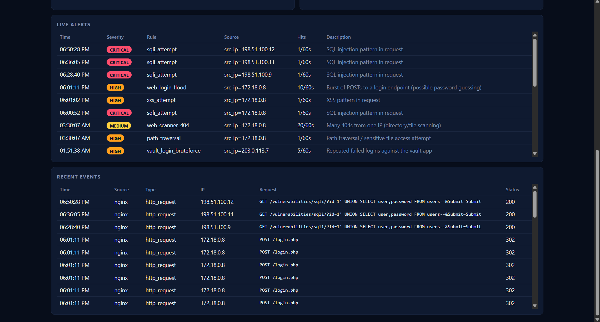
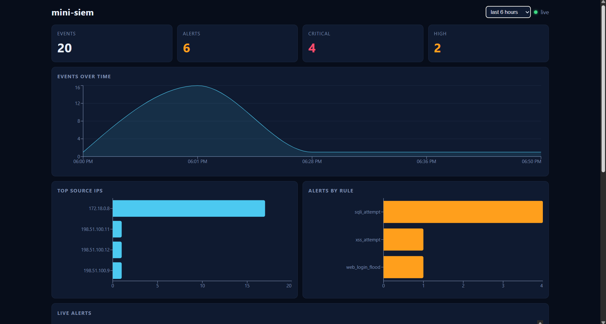
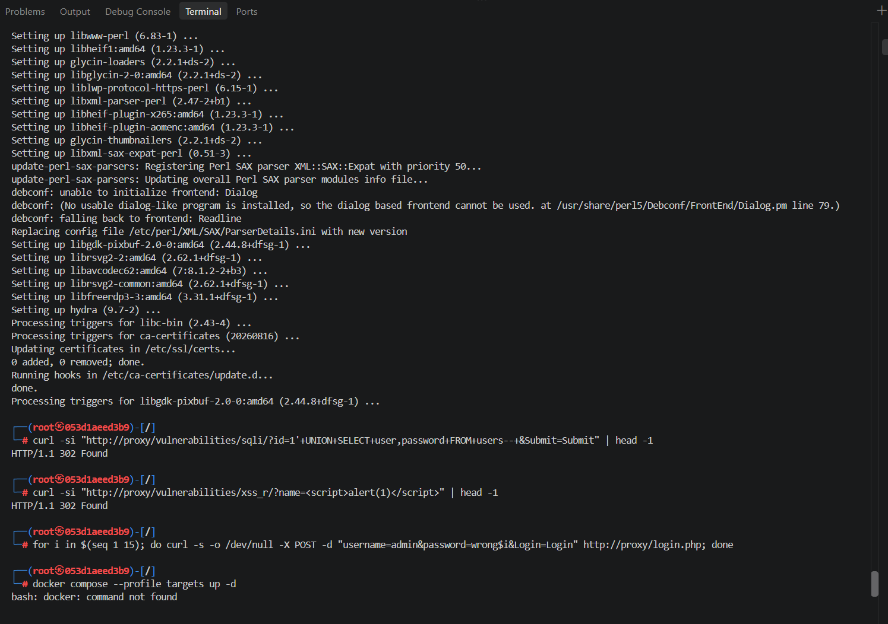
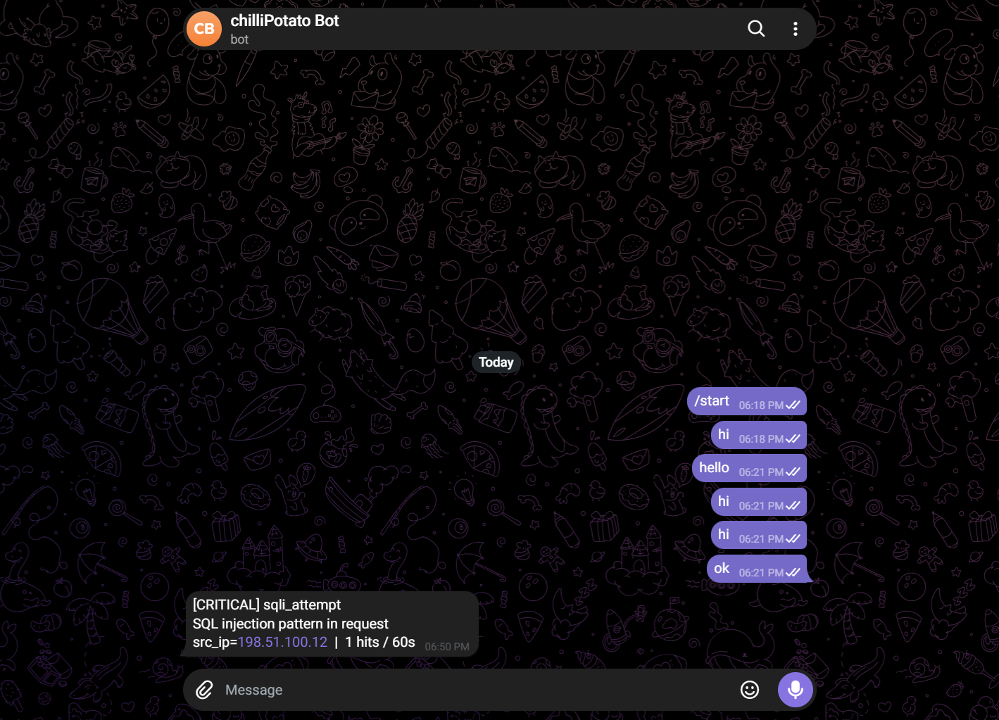

# mini-siem

A small SIEM built from scratch: it tails logs, parses them into events, detects attacks with sliding-window rules, stores everything in Postgres, shows a live dashboard, and sends alerts to Telegram. Tested by attacking a deliberately vulnerable app (DVWA) from a Kali container.



## Architecture

```
logs (nginx / ssh / app JSON)
        |
   collector (watchdog) --> parser --> Postgres (events, alerts)
                              |
                         rules engine (YAML + Redis sliding windows)
                              |
                       alerts: console + Telegram
                                  
FastAPI (/api/events, /api/alerts, /api/stats) --> React dashboard
```

Stack: Python, FastAPI, Postgres, Redis, React + Vite + Recharts, Docker Compose.

## Detection rules

| Rule | Trigger |
|------|---------|
| ssh_bruteforce | 5 failed SSH logins from one IP in 60s |
| web_login_flood | 10 POSTs to a login path in 60s |
| web_scanner_404 | 20 x 404 from one IP in 60s |
| sqli_attempt | SQL injection pattern in request |
| xss_attempt | XSS pattern in request |
| path_traversal | `../` or `/etc/passwd` style access |
| vault_login_bruteforce | 5 failed logins in 60s on an app log |

Rules live in `backend/rules/rules.yml`, so adding one needs no code change.

## Tested against real attacks

| Attack (from Kali) | Detected by |
|--------------------|-------------|
| `curl` with `UNION SELECT` payload | sqli_attempt |
| `curl` with `<script>` payload | xss_attempt |
| 15 POSTs to `/login.php` | web_login_flood |
| `nikto` scan (7,794 requests in 16s) | web_scanner_404 and others |

The SSH and app-log rules were tested with the included attack simulator (`scripts/attack_sim.py`).




## Quick start

```
cp .env.example .env              # optional: add Telegram token + chat id
docker compose up -d --build      # postgres, redis, collector, api (:8000)
cd dashboard && npm install && npm run dev    # dashboard on :5173
py scripts/attack_sim.py all      # fake attacks (use python on Mac/Linux)
```

Real targets: `docker compose --profile targets up -d` starts DVWA behind an nginx proxy on :8080, which writes the access log the collector reads.

## Design decisions

- **Sliding window in Redis**: one sorted set per rule and IP, event time as score. Each hit trims old entries, adds itself, and counts what is left.
- **Alert cooldown**: `SET NX EX` per rule and IP, so one attack sends one alert, not hundreds.
- **Double URL-decoding** of request paths before matching, to catch double-encoded payloads.
- **Telegram sends in a background thread** with retries, so a slow network never blocks detection.
- **Polling file watcher**, so it works on Docker bind mounts on Windows and Mac.

## Limitations and next steps

- Rules are regex and threshold based, so they can be bypassed and can false-positive.
- Behind the proxy, attackers appear as the Docker gateway or container IP.
- No correlation yet (for example brute force followed by a successful login), no GeoIP, no auth on the API.

## Tests

```
cd backend && pip install -r requirements-dev.txt && pytest
```